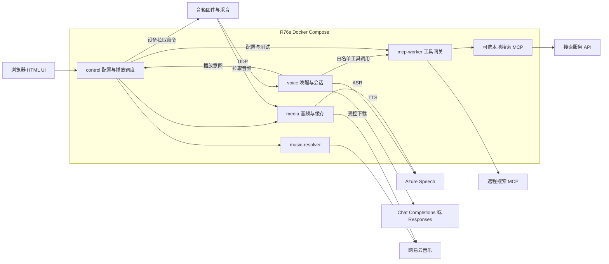

# R76s Docker 化与云端语音改造执行计划

本文保留改造设计与原缺陷基线。2026-11-03 已实现第三代 Compose、HTML 管理界面、唯一播放调度器、设备 v2 协议、双 LLM 协议、Azure Speech 和 MCP 客户端的离线候选版本；不代表 R76s、音箱或真实云服务已验收。具体部署和剩余门槛见 [11-R76s 部署与验收](11-R76s-部署与验收.md)。未访问音箱、调用付费 API 或调整家庭网络。

## 实施进度（2026-11-03）

新增运行入口位于 `src/spk_platform/`，由 `Dockerfile` 和 `compose.yaml` 提供服务。Python 3.11.18/3.12.3 各 61 项离线测试通过，包含真实无声媒体转码、连续会话事件、MCP stdio 和模拟设备闭环；Compose 所有 profile 配置校验通过，桌面/手机浏览器配置与工具发现验证通过。Docker daemon、R76s、真实账号、可听输出、48 小时稳定性尚未验收，不能将计划各阶段全部标记为完成。

- 已修复 netd 缺少 token 时匿名放行；运行前需在服务账号 `~/.spk_net_token` 和设备 `/mnt/UDISK/spk/net.token` 安全配置同一令牌，两端文件权限均应为 0600。
- 已拒绝媒体根内符号链接，修正空媒体文件长度；MP3 服务仍以 `/tmp` 为默认根，尚未迁移到专用媒体目录。
- 已拒绝 HTTP 错误页和非 MP3 签名的音乐缓存；配置空值/CIDR 校验及 LLM 示例命名已对齐；TTS `/new` 已增加令牌、请求大小、文本、并发和速率限制。
- 已修复 netguard 离线测试路径。以上仅有隔离检查；依赖安装、全量回归、R76s/音箱实测和云端调用仍未完成。

## 1. 结论与范围

建议保留已经走通的音箱采音与原生播放链路，把外置“大脑”改造成全部运行在 R76s Docker Compose 中的服务。音乐作为独立核心能力，不能依附于一次 LLM 请求或闹钟线程；先交付可通过浏览器稳定点歌的版本，再接入 Azure 语音和两种 LLM 协议。

| 用户要求 | 当前情况 | 目标 |
| --- | --- | --- |
| 本地服务全部在 R76s，以 Docker 运行 | systemd 部署，路径和进程依赖分散；没有容器构建及依赖锁定清单 | R76s 上统一 Compose；不依赖另一台电脑上的 Python、Node、模型或后台服务 |
| HTML 配置 UI | 没有配置页面 | 中文响应式管理页面，包含音乐、设备、云服务、诊断和备份 |
| Azure ASR/TTS | 本地 sherpa ASR；Qwen/Edge TTS | Azure Speech 为默认 ASR/TTS；本地仅保留必要的唤醒、VAD 和音频处理 |
| Chat Completions + Responses、模型自发现 | 实际使用 Anthropic Messages 协议 | 两个独立适配器；模型列表、文本调用、工具调用分别检测 |
| R76s + UI 配置 MCP，为 LLM 增加联网搜索 | 现有执行方案尚无 MCP 接入层 | R76s 容器运行 MCP 客户端及受控本地服务；UI 配置服务、凭据、工具权限和搜索策略，两种 LLM 协议共用 |
| 音乐为核心 | 有点歌、缓存和本地文件播放，但没有可靠的统一队列与播放所有权 | UI 与语音共用音乐服务；云端语音故障不影响 UI 播放缓存音乐 |
| 优化与 bug 排查 | 已发现配置、控制并发、HTTP 服务及测试可移植性问题 | 按下表修复并固化成离线回归测试 |

“全部本地服务迁入 R76s”不包括音箱内必须保留的固件、采音注入库、原生播放器和守护脚本。这些直接操作音箱硬件，不应迁进 R76s 容器。第一版不刷固件、不改 DSP、不接管声卡、不更换现有 Wi-Fi 拓扑。

## 2. 优先处理的问题

P1 表示开放 Web 管理及日常使用前应解决；P2 表示体验、兼容性或维护问题。“已复现”指本机隔离测试，不是音箱实测；“源码风险”表示可见的控制流问题，但未做真机并发复现。

| 优先级 | 问题与证据 | 影响及处理 |
| --- | --- | --- |
| P1 | [src/spk_netd.py](../src/spk_netd.py#L126)：服务端 token 文件缺失时 `_auth()` 曾放行，已改为拒绝并返回 503 | 主机 `~/.spk_net_token` 与设备 `/mnt/UDISK/spk/net.token` 必须一致；部署令牌生成、轮换流程和设备实测待完成 |
| P1 | [src/mp3srv.py](../src/mp3srv.py#L59)：已拒绝符号链接和解析越界；默认根仍为 `/tmp` | 尚需迁移到专用媒体目录、限制挂载范围，并与所有写入 `/tmp` 的音频调用方一并迁移 |
| P1 | [src/spk_netd.py](../src/spk_netd.py#L210)：`post()` 写单一命令槽；先写 stop 再写 play，只剩 play，已复现 | 不是 FIFO；UI、语音、闹钟会互相覆盖。增加命令 ID、串行发送、结果关联、过期与取消；中断命令有独立优先级 |
| P1 | [src/spk_alarm.py](../src/spk_alarm.py#L1044)：每次 `ring_bg()` 启动线程，`ring()` 的 `finally` 无条件 stop，源码风险 | 旧任务结束可能停止新歌/TTS。由唯一播放器调度器持有 `playback_id` 和代次，旧任务不能清理新任务 |
| P1 | [src/spk_alarm.py](../src/spk_alarm.py#L651)：已增加 curl HTTP 失败检查、MP3 签名检查，校验后原子发布 | 下载中上限、真实媒体探测和完整缓存回归仍待补齐 |
| P1 | [config/spk_config.py](../config/spk_config.py#L63) 与 [config/spk.env.example](../config/spk.env.example#L25)：空数据目录回退仓库根；空 CIDR 明确拒绝所有来源；非法 CIDR 报错 | 示例已注释空 CIDR 以采用默认网段；专用容器数据路径和待配置状态仍待实施 |
| P1 | [src/spkbrain-macmini.py](../src/spkbrain-macmini.py#L183) 与 [src/spk_ai_dlna.py](../src/spk_ai_dlna.py#L86)：示例已改用 `DS_KEY` / `DS_MODEL`，共享配置优先读取 `DS_MODEL` 并兼容旧模型变量 | 统一所有入口的设置对象、旧密钥迁移和移除个人 Claude 配置回退仍待实施 |
| P1 | [src/spk_tts_stream.py](../src/spk_tts_stream.py#L447)：`POST /new` 已增加令牌鉴权、请求/文本上限、并发上限和来源速率限制 | 令牌默认取服务账号 `~/.spk_tts_stream_token`；尚需将令牌初始化与轮换纳入正式部署流程 |
| P2 | [src/spk_ctl.py](../src/spk_ctl.py#L164)：601 的 pause 实际 stop，resume 从头播放；[src/spk_skills.py](../src/spk_skills.py#L1427) 却回复“已暂停” | 属于能力限制与反馈错误。第一版明确提供“停止”“重新播放”；真暂停/拖动只有硬件验证后才能启用 |
| P2 | [src/spk_ctl.py](../src/spk_ctl.py#L223)：`now_playing()` 无条件调用 DLNA `GetPositionInfo`，隔离模拟已确认 | 601 正常工作也可能查不到曲目。按 transport 分派，并区分期望曲目、设备状态、未知状态 |
| P2 | [src/mp3srv.py](../src/mp3srv.py#L112)：空文件 Content-Length 已修正为 0 | HEAD/Range/416 与并发文件替换的完整回归仍待补齐 |
| P2 | [src/spk_test_netguard_pm.py](../src/spk_test_netguard_pm.py#L26)：仓库相对路径已修复，离线测试断言通过 | 仍需纳入统一测试运行入口 |
| P2 | [src/install.sh](../src/install.sh)：仍部署早期 DNS/AP 拦截方案 | 不能当作当前代部署入口。保留历史用途说明，新增第三代 Compose 部署和回滚流程，不自动运行旧安装器 |

设备命令提交目前是本地文件/函数调用，不是公开的 HTTP 任意命令提交接口；上述鉴权问题不能表述成已经验证的远程命令执行。不过 [device/spk_net.sh](../device/spk_net.sh) 会执行拉取到的 shell 文本，且拉取未使用 HTTP 失败检查，因此升级协议时必须同时收紧设备端解析，不能直接把 shell 文本接口暴露给 UI 或 LLM。

## 3. 当前链路与可复用部分

```text
音箱 netease_voice + mictap
  -> UDP 麦克风流
  -> spk_ear：本地唤醒 / VAD / ASR / 会话及打断
  -> spk_skills：工具调用循环
  -> 云端 LLM、TTS，或音乐选曲
  -> 音箱通过 HTTP 拉音频
  -> 设备 D-Bus 0x601 播放 / 0x603 停止 -> ihwplayer
```

当前默认播放是 601，不是文件名暗示的 DLNA。应复用 [src/spk_ctl.py](../src/spk_ctl.py)、[src/spk_ai_dlna.py](../src/spk_ai_dlna.py) 中有硬件依据的部分，包括短音频、尾部截断、静音填充、原生播放器状态和交付检查。先封装成设备适配层，不在迁移时顺便重写。

必须区分四种证据：命令已提交、设备已取音频、播放器报告 playing、实际听到声音。HTTP 200 或 fetch 日志不是“已出声”；固件 AEC 也会影响自监听，不能据此自动宣布播放成功。D-Bus `NoReply` 则可能是接收端不回复，不能单凭发送命令退出码判失败。

### 音乐现状

```text
play_music
  -> spk_alarm：搜索 / 选曲 / 缓存 / 本地文件
  -> ncm-cli + PlayerDaemon
  -> ncm_player 模拟 mpv，通过 JSON IPC 捕获 loadfile URL
  -> 音箱直接拉在线 URL，或拉宿主机的缓存文件
  -> 另起 curl 下载在线歌曲作为缓存
```

- [src/ncm_player.py](../src/ncm_player.py) 是 URL 捕获器，不是在大脑主机上播放音乐的 mpv。
- 已有点名选歌、随机缓存/本地曲目、闹钟、夜间限制、失效曲目标记及跨进程锁，值得保留。
- 当前“边播边缓存”是音箱拉一次、主机再拉一次，不是单次上游下载的缓存代理。
- 缓存已有 300 MB 总量、40 MB 单文件、2 GB 磁盘余量等默认限制；需要变成设置，并在下载过程中执行限制。
- ncm-cli 安装目录、模拟 mpv 启动包装、登录态、模型、个人音乐等不随仓库完整提供；干净构建必须显式补齐，不能复制作者的整个 home。
- 播放依附闹钟线程且先报“开始放”，没有统一的队列、请求归属和可信进度。601 真暂停、seek 以及有效音乐音量控制不能视为已具备。

## 4. R76s 容器架构

### 4.1 部署前置检查

R76s 的架构已由用户确认是 ARM64；内存、操作系统及 Docker 状态仍待目标机核对。阶段 0 核对 OS 版本、可用 RAM/磁盘、Docker Engine/Compose、内核网络能力、LAN 地址、代理/DNS、系统时间与家庭主路由职责。双架构构建和新增手机/UI 需求见 [手机播放与主题](12-手机播放与主题.md)。

建议先以 Python 3.11 + Debian 12/glibc 系列基础镜像做兼容性验证，锁定镜像摘要和 Python/Node 依赖。Azure Speech SDK 文档列有 Linux x64/ARM64 支持，但这不等于已经验证本机 wheel、动态库和模型运行；阶段 0 必须在实际架构运行 SDK 导入、音频流输入、ffmpeg 和 KWS/VAD 的最小测试。先不以 Alpine/musl 为基线，也不默认需要 GPU/NPU。

4 GB RAM、至少 10 GB 可用数据空间可作为初始规划预算，不是实测最低要求；要预留 R76s 现有服务余量。若资源不足，先去掉可选本地完整 ASR/声纹模型，不牺牲路由稳定性。

### 4.2 服务划分

建议四个基础服务加一个 MCP 工具网关；未启用 MCP 时可关闭网关，自建搜索 MCP 服务按需增加 Compose profile。Python 基础服务复用同一版本镜像，通过不同入口启动；第三方 MCP 运行环境单独锁定。模块划分不意味着每个模块都要一个容器。

| 服务 | 职责 | 持久化与权限 |
| --- | --- | --- |
| `control` | HTML/API、配置、设备命令队列、唯一播放调度器、闹钟、状态事件 | 唯一写入配置/业务 SQLite 的服务；不允许 UI 直接执行 shell |
| `voice` | UDP 收音、唤醒/VAD、Azure ASR、会话、两种 LLM 协议、打断判断 | 模型只读；通过内部 API 提交播放意图，不能绕过调度器操作设备 |
| `media` | Azure TTS、音频转码/填充、媒体 HTTP、音乐下载及缓存代理 | 专用媒体目录；不挂载整个 `/tmp` 或业务数据库；合成与转码有并发上限 |
| `music-resolver` | 封装 ncm-cli 搜索、歌单、账号状态及取流地址 | Node 与 CLI 版本锁定，独立账号卷；初期串行使用共享 IPC，不开放 LAN 端口 |
| `mcp-worker` | MCP 客户端、连接/会话管理、工具发现与调用；连接远程或 R76s 本地的搜索 MCP 服务 | 只接收所需 MCP 凭据；独立网络和资源限额，不挂载音乐账号、家庭记忆或设备令牌，不开放 LAN 端口 |

不引入 Redis、独立数据库服务器或 Kubernetes。SQLite 由 `control` 单点管理，其他服务走内部 API，不跨容器直接写同一个数据库。HTTPS 可复用 R76s 上现有的容器反向代理；没有时再添加一个轻量网关容器。



### 4.3 网络与存储契约

默认使用 bridge 网络、明确发布端口、配置音箱 IP，不依赖 DLNA 多播发现。必须测试容器接收 UDP 后的来源 IP 与白名单匹配；仅在实际网络证明 bridge 无法满足时，才评估 voice 的 host 网络方案。

| 端口 | 处理方式 |
| --- | --- |
| 新管理端口，例如 TCP 8080 | `control` 提供 UI/API；绑定指定 LAN 地址；实际端口先检查冲突，正式输入密钥走 HTTPS |
| TCP 8898 | 设备命令轮询及结果；只允许音箱网段/地址，必须鉴权 |
| TCP 8899 | 音箱媒体读取；只读能力、短时媒体票据与网络限制，保持 Range 兼容 |
| TCP 8896 | 现有 TTS 创建接口改成容器内部调用；音箱的实际流读取经媒体出口提供 |
| UDP 9998；TCP/UDP 9997 | 麦克风与设备唤醒；现有 waketap 实际走 TCP 9997，voice 兼容 TCP/UDP |
| UDP 9999 | 当前自监听转发；留在 voice 网络命名空间内，若拆消费者则显式改地址，不公开到 LAN |

拆开 `bind_address`、容器内部服务 URL 与音箱可访问的 `advertised_media_url`。音箱拿到的 URL 不能是 `127.0.0.1`、`0.0.0.0` 或 Compose 服务名。当前 [src/spk_tts_stream.py](../src/spk_tts_stream.py#L383) 的 `wait_file()` 依赖共享 `/tmp` 文件，迁移后改为媒体 ID/就绪状态/下载接口，或显式共享专用卷，不能假设容器 `/tmp` 相通。

数据分别存入配置/密钥、业务数据库、音乐缓存、临时 TTS、只读模型、音乐登录态卷。清缓存不能删除账号或记忆。日志走 stdout 并设置 Docker 轮转；原有解析媒体日志的逻辑迁成带 `playback_id` 的事件后才能去掉旧日志契约。

容器使用非 root、`init: true`、合理的 CPU/RAM/PID 限额、健康检查和 `unless-stopped`。不使用 privileged、不挂 Docker socket、不挂宿主机声卡；在线健康检查不调用计费接口。运行时不依赖另一个主机的 USB ADB；闹钟解除夜间静音等动作改走设备受限命令，USB 仅保留为经确认的维护手段。

MCP 网关仅提供容器内部鉴权接口。远程 MCP 默认使用 HTTPS Streamable HTTP；本地 HTTP MCP 使用单独受限网络中的 Compose 地址，不能把容器内 `localhost` 当作其他服务。网络与出口策略阻止第三方 MCP 访问设备控制、宿主机管理口及云元数据；确需内网连接时逐项放行。自建搜索服务和 stdio 子进程同样在 R76s 容器内运行，不依赖宿主机的 `npx`、`uvx` 或 Python。

## 5. 配置 HTML UI

后端建议 FastAPI + Pydantic；首版采用服务端模板 + 本地打包的少量 JavaScript/CSS，避免为配置页引入常驻前端开发服务。SSE 推送播放/诊断状态。页面与 API 同源，手机和桌面都可用；所有云请求由 R76s 后端发起。

| 页面 | 必备内容 |
| --- | --- |
| 音乐，作为默认首页 | 当前曲目/来源/状态、搜索与候选、队列、播放/停止/重播、上下首、缓存/本地音乐、账号状态；只展示实际支持的控制 |
| Azure Speech | ASR 与 TTS 各自的 Endpoint、Key，可复用同一资源；Region/云环境、语言、动态音色列表、语速和 TTS 增益；分别测试 |
| LLM | Endpoint、Key、协议选择、发现模型/刷新、手填模型、默认模型、超时；文本测试与工具调用测试分开 |
| MCP 与联网搜索 | 服务增删改/启停、传输类型、Endpoint 或已安装本地模板、鉴权与密钥引用；发现/刷新工具、逐项白名单、默认搜索工具、搜索策略、超时/配额、分层测试、最近错误及结果来源 |
| 设备与声音 | 音箱 IP、允许网段、媒体地址、在线时间、最近 UDP 包、唤醒/VAD、夜间规则；TTS 增益与音乐音量分开 |
| 诊断与维护 | 配置版本、服务状态、各阶段耗时、脱敏错误、存储用量、备份/恢复；不提供任意命令控制台 |

### 配置生命周期

1. 建立一个带 `schema_version` / revision 的类型化配置对象；UI 保存结构化设置，不直接编辑 shell/Python 源码。
2. 字段级校验 Endpoint、路径、端口、CIDR、语言、音色及额度；设置 draft 不影响当前运行版本。
3. “测试”针对指定 draft 和密钥版本执行；响应包含测试阶段、耗时和错误分类，不把 HTTP 200 当全链路成功。
4. “应用”原子生成新版本；服务在新会话/新任务边界获取不可变配置快照，旧任务继续使用旧版或明确取消，不能混用两套 Key/Endpoint。
5. 显示 saved/applied revision、待重启字段及被环境变量覆盖的只读字段；端口/卷变化不伪装成热更新。失败保留旧版，可回滚。
6. 迁移导入 `DS_*` 等旧变量，给出冲突提示；环境覆盖有显式锁定状态，避免页面保存成功却永远不生效。

### 密钥与接口安全

- 管理员必须登录；首次初始化只经可信本机通道或 HTTPS 完成。写 API 有 CSRF/Origin 校验，登录与探测限速，默认不开放公网。
- Key 仅写入后端受限密钥存储，响应只含 `configured`、掩码和版本；掩码不能覆盖真实密钥，清空必须显式操作。不存浏览器 localStorage，不进入镜像、Git、日志或普通导出。
- 若使用加密数据库，解密主密钥必须在数据库卷之外独立管理；备份及轮换流程一起实现，不把“同目录加密”当安全边界。
- 自定义 Endpoint 默认 HTTPS 且校验证书。阻止 URL userinfo、云元数据地址、未批准内网目标及跨主机携带密钥重定向；DNS/重定向目的地址也需检查。局域网模型网关只能由管理员明确加入允许列表。
- 云端测试分为“凭据/目录”“小额真实调用”“音箱出声”；后两项明确触发，不作为页面打开或健康检查的副作用。设备命令与媒体票据不能复用管理员会话。

## 6. Azure Speech 接入

### ASR

默认采用 Azure Speech SDK 的音频输入流和连续识别。接入点是 [src/spk_ear.py](../src/spk_ear.py) 的音频处理、`asr_text()`、`LiveAsr` 及其调用者，不只是替换模型加载函数。

1. 保留当前唤醒、VAD、预录缓冲和打断控制，将 16 kHz 单声道 float32 正确裁剪并转成 little-endian PCM16，声明格式后写入 SDK 输入流；避免重复加增益。
2. 仅在唤醒/有效会话期间上送语音，并补入必要预录，避免持续上传家庭环境声；关闭会话时停止流、清理回调与缓冲。
3. 把识别中的 partial、最终文本、无匹配、取消和超时映射到统一事件；旧会话回调不得触发新一轮命令。不要让本地 VAD 和云端分句各执行一次点歌。
4. 云端不可用时保留 UI、音乐和本地提示音；可选本地 ASR 后备需另行配置模型及资源预算，不能默认存在。立即停止类安全控制应尽量保留本地路径。

短音频 REST 适合作为探测或首个验证步骤，不作为连续对话的等价替代：官方限制单段最多 60 秒且只返回最终结果。测试应发送已获授权的短样本，并检查 `RecognitionStatus` 和文本，而不是只检查 HTTP 状态。

### TTS

1. 新增明确的 Azure provider，不把 engine 设置成 `azure` 后继续落入现有 Qwen 分支。取音色列表，按实际 Region/Endpoint 筛选；Speech 的 Key 与 LLM Key 相互独立。
2. 用结构化 XML/SSML 构建并转义文本；设置音色、语速及输出格式，处理空文本、长文本、限流、鉴权失败和取消。
3. 先实现“完整合成 -> 转码/填充 -> HTTP 播放”的可靠版本，再实现边合成边播。当前链路为 48 kHz/单声道/128 kbps；Azure 48 kHz MP3 的文档档位不同，首版统一归一化，不直接拼接不同编码参数的静音与音频。
4. 保留固件短音频和尾部保护，逐段验证首字、尾字及完成事件；每个作业使用独立文件/目录，禁止共享固定临时文件名。
5. 打断时取消云请求、转码、媒体流与设备播放；已取消任务的迟到首包不能恢复出声。仅缓存允许保留的提示音/合成结果并设置 TTL。

Endpoint 按 Azure Speech 的 Region、资源自定义域名及云环境处理；不要从任意域名猜 Region，也不要把 Azure OpenAI 的音频接口当作 Azure Speech。流式和文件模式的测试必须分开统计延迟。

## 7. LLM 双协议与模型发现

保留 [src/spk_skills.py](../src/spk_skills.py) 的工具白名单、会话逻辑和 dry 模式，把 [src/spk_ai_dlna.py](../src/spk_ai_dlna.py#L1818) 中的厂商 HTTP 协议抽出。内部统一为消息、工具定义、工具调用、工具结果、文本增量、终止原因和 usage；使用成熟的 OpenAI Python SDK，并锁定版本，不自行拼装 SSE 解析器。

| 契约 | Chat Completions | Responses |
| --- | --- | --- |
| 请求路径 | 配置好的 API base 下 `chat/completions` | 同一 base 下 `responses` |
| 消息 | `messages` | `input`，系统规则通过适配器传递 |
| 工具定义 | `type=function`，函数定义在 `function` 内 | `type=function`，名称/参数在工具对象上 |
| 模型请求工具 | assistant `tool_calls` | output 中 `function_call` |
| 回传结果 | `role=tool` + `tool_call_id` | `function_call_output` + 对应 `call_id` |
| 流式 | choices/delta、分片工具参数、完成原因 | 类型化文本/工具事件、completed/failed/incomplete |

实现要求：

- 支持完整多轮工具闭环，不只做一次“你好”测试；工具参数完成后再验证 JSON Schema 并执行，多个副作用工具串行交给调度器。
- 同一次工具调用重试不能重复点歌/设闹钟；为会话和调用建立幂等记录，限制轮数、总耗时、并发和 token。
- Responses 默认本地管理历史并在支持时设置 `store=false`，保留继续调用所需的完整 output items，包括不透明推理状态；不能只保存可读文本。`store=false` 不等于服务商全面零留存。
- 若启用 `previous_response_id`，每轮仍传必要规则和工具；切换 Endpoint、模型或协议时清理不兼容状态，不能跨服务商复用 ID。
- `thinking`、temperature、token 上限等按 provider/模型能力传递，不把 DeepSeek 专用参数发给所有兼容端点。不擅自切换协议重放已执行的副作用。
- 普通 OpenAI-compatible 默认 Bearer 鉴权。若选择 Azure OpenAI v1，使用其专用 Endpoint/鉴权设置，`model` 是部署名称；Azure Speech 与 Azure OpenAI 是两种不同资源。

### 自发现和连通性判定

1. 对支持的供应商调用 `GET <api_base>/models`，解析 ID、去重、缓存并允许手动刷新；保留自定义 base 的路径前缀，避免重复添加 `/v1`。
2. 模型列表失败时区分无权限、接口不存在、网络故障；允许手工输入 ID。列表接口缺失不等于推理接口不可用，列表里出现也不等于可调用。
3. 用户选择模型后，按所选协议发送最小文本请求，展示结果、协议、模型、延迟与计费提示。只测试选中模型，不自动对全列表发付费请求。
4. 再用无副作用的测试工具完成“请求调用 -> 验参 -> 返回固定结果 -> 模型总结”，独立标记工具能力；不调用真实播放、文件或 shell 工具。
5. 流式能力单独检测，处理 HTTP 200 后的流内错误和中断。结果按 Endpoint、密钥版本、模型、协议和配置版本隔离，修改后失效。
6. 若供应商要求用管理面权限列出部署，不能宣称仅凭推理 Key 就能完整发现。Azure 的模型目录不应当作本资源已部署列表；首版允许手填部署名，有必要再增加可选管理面发现。

UI 至少显示“目录可读 / 文本可调用 / 工具可调用 / 流式可用”四种独立状态；未知保持未知，不能统一显示一个绿色“连接成功”。

### MCP 与联网搜索

MCP 是工具接入协议，不自带搜索引擎。必须配置实际提供搜索工具的 MCP 服务及其所需搜索 API 凭据，费用、配额和可用性独立于 LLM。首版选一个已验证的只读搜索 provider 跑通全链路，支持后续增加服务；不以通用浏览器自动化或 shell 工具代替搜索。

#### 运行与协议桥接

```text
用户问题 -> LLM 请求搜索工具
  -> R76s 工具白名单与参数校验 -> mcp-worker
  -> 搜索 MCP 服务 -> 搜索结果与来源
  -> 对应 LLM 协议的工具结果 -> 回答 / TTS / UI 来源列表
```

- 使用官方 MCP SDK 并锁定版本，完成初始化、协议/能力协商、会话生命周期、分页 `tools/list` 和 `tools/call`，不手写协议解析器。服务端 `isError`、传输异常和取消分别处理。
- 首版优先支持远程和本地的 Streamable HTTP。stdio 通过预先审核、固定依赖的容器模板启动本容器子进程，UI 仅选择已安装模板和校验后的参数；不允许输入任意 command、执行 shell、动态安装包或操作 Docker socket。只支持旧 HTTP+SSE 的服务明确标注需兼容适配，不静默视作 Streamable HTTP。
- MCP 客户端在 R76s 执行，将获批工具 schema 转成第 7 节的两种 function tool 格式，并按 `tool_call_id` / `call_id` 回传结果；LLM 不直接连接家中 MCP。Responses 的服务商原生远程 MCP 功能不作为首版依赖，因此 Chat Completions 也能使用同一套搜索工具。
- 使用稳定的服务/工具命名空间，并满足模型工具名长度及字符限制，冲突时拒绝注册，不能覆盖 `play_music` 等本地工具。对不兼容的 schema 明确报告，不静默删除约束；执行前仍在 R76s 验参。
- 工具目录、schema 与授权带版本快照。新工具及 schema/描述变更需管理员重新审核，不能因刷新目录自动获得权限；禁用服务立即撤销调用资格、取消未完成调用并丢弃迟到结果。

#### UI 配置与探测

配置字段包括 `server_id`、名称、启用状态、传输方式、Endpoint/本地模板、鉴权方式、密钥引用、允许工具、默认搜索工具及其参数映射、超时、最大并发、单轮调用数、最大结果数/字节和缓存 TTL。每个 LLM 配置可选择获准的 MCP 工具集；不因添加服务就把全部工具传给全部模型。

首版支持无鉴权的受限本地服务及远程 Bearer/API Key 请求头；敏感 header/environment 值走第 5 节密钥存储，不回显、不继承整个应用环境。服务要求 OAuth 时显示明确的未支持状态，需增加符合 MCP 授权规范的流程后才能启用，不能把任意静态 Key 当成 OAuth 等价物。

UI 分四步检测：协议握手、工具发现、用户确认的一次搜索工具调用、所选 LLM 的搜索闭环。分别显示结果和耗时；HTTP 200、工具目录可读、真实搜索成功、模型能引用搜索结果是不同结论。真实搜索可能收费，不在开页或健康检查时自动执行。

搜索模式提供“关闭 / 自动 / 仅明确要求联网”。默认关闭，管理员授权后启用；自动模式仅向已通过工具调用测试的模型开放选定工具，普通音乐控制不自动触发搜索。UI 提供测试查询、结果预览、工具选择及配额状态，搜索失败不宣称已联网查证。

#### 结果、安全与降级

- 保留标题、URL、摘要、检索时间及可用的发布时间，标明缓存命中和时效；UI 将来源作为正常文本与安全链接显示，转义 HTML、拒绝非 HTTP(S) 链接，不插入服务返回的原始 HTML。TTS 简述结论和必要来源，不逐字朗读长 URL，不伪造引用。
- MCP 工具描述、搜索摘要和网页正文都视为不可信数据，不作为系统指令，不得因此读取密钥/家庭记忆、执行 shell 或新增工具授权。只发送完成搜索所需的查询，不上传整段对话、原始录音或凭据。
- 搜索工具的“只读”由审核和执行权限保证，不能仅相信服务自报的 annotations。MCP 入口沿用 Endpoint/SSRF/重定向防护；网页抓取若确有必要，作为单独获批工具配置，使用网络出口限制约束第三方实现。
- 调用设置总 deadline、并发/轮数/结果大小限制、限速和熔断；缓存按服务、凭据版本、工具、参数及 TTL 隔离，敏感查询不缓存。日志仅保留必要的脱敏审计信息；服务删除、密钥轮换和配置回滚处理相应连接与缓存。
- 搜索超时、限流、无结果或返回错误时，让 LLM 明确缺少联网依据并继续可用功能；不阻塞音乐播放/停止。用户打断同时取消搜索及后续回答，失败不能回退到未授权的服务商内建搜索或其他工具。

## 8. 音乐核心改造

### 8.1 独立音乐能力

将搜索、曲目元数据、取流和缓存决策从 [src/spk_alarm.py](../src/spk_alarm.py) 分离；闹钟只负责何时提交任务。第一阶段保留 ncm-cli provider，明确登录流程、凭据持久化、版本与许可证；只有维护性或接口可用性证明不足时才更换提供方，不同时引入另一套未验证音乐后端。

首版范围：歌名/歌手搜索与候选选择、账号及歌单状态、缓存/本地音乐、队列、上下首、随机/循环、停止/重新播放、夜间与闹钟策略。账号可用时使用其合法播放权限；无权限曲目明确反馈或选择用户允许的候选，不绕过会员/版权限制。

### 8.2 唯一播放调度器

- UI、LLM、闹钟、TTS 都提交类型化任务。状态为 queued/resolving/buffering/playing/stopping/completed/failed/cancelled，保留 `request_id`、`playback_id`、来源和错误原因。
- 只有调度器能发送设备 play/stop。命令带 ID、TTL 和 generation；设备确认与结果关联。轮询丢包可重发，但执行去重；设备重启后标记不确定状态并核对，不宣称分布式绝对 exactly-once。
- 设备侧只接受已定义的动作和经过严格校验的参数；过渡期将参数交给固定脚本、正确转义并检查响应状态，最终移除通用 `sh -c` 输入。
- 用户停止优先级最高，取消当前作业及其迟到结果；闹钟、对话 TTS、普通音乐有可配置优先级。先定义中断后停止或重播，不承诺没有硬件支持的断点续播。
- 当前曲目持久化“期望状态”，设备状态带时间戳，过期变为 unknown。自然结束、用户停止和故障要区分，不能都触发下一首；设备事件不足时先定义保守降级再开放自动续播。
- 修复“提前报成功”：提交时显示“正在准备”，取流/命令/播放状态到达后再更新；失败不能仍口头表示“已经播放”。

### 8.3 媒体与缓存

先交付稳定的完整下载/缓存播放及有界超时，再优化成 R76s 单上游流下载并向音箱分发，减少双重下载、短期 URL 暴露及旧固件 TLS 兼容负担。完整文件的 Range 与进行中流要分别处理，不能把不断增长的文件按固定长度返回；首包、重连和固件填充必须实机验证。

缓存键包含 provider、曲目 ID、音质/编码；在线 URL 过期时重新解析，不能将它当永久曲目标识。同一曲目只允许一个下载者，使用唯一临时文件、流量/时长/磁盘上限、音频探测和原子发布，拒绝 HTML 错误页。淘汰策略保护正在播放和下载的文件；用户能关闭在线缓存并单独清理。

媒体代理只接受音乐 provider 解析后的资源或受控媒体 ID，不提供任意 URL 代理；校验每次重定向、超时和目标网络。浏览器上传本地音乐时限制大小、格式和路径，在沙箱化/限资源进程中探测媒体。

音量先分清 TTS 合成增益和音乐输出：当前 DLNA 音量是无效影子值，不能做成看似可用的总音量滑块。第一版保留物理音量控制；软件音乐增益或 601 原生音量需单独验证并设置保守上限，不沿用最大音量做实验。

## 9. 执行顺序与交付物

以下是单人全职、设备和账号可配合测试时的工程估算，不是已验证工期。原方案约 21-30 人日；增加 MCP 首版约 3-5 人日，合计约 24-35 人日。该增量以一个搜索 provider、Streamable HTTP 和受控 stdio 模板为范围，不含通用 OAuth、旧 SSE 兼容及任意第三方服务适配，另留第三方服务/固件兼容性缓冲；48 小时稳定性观察可与文档整理重叠。每阶段通过门槛后再切换实际使用。

| 阶段 | 预计 | 工作与主要改动面 | 完成门槛 |
| --- | --- | --- | --- |
| 0. 目标机与基线 | 0.5-1 日 | 核对 R76s、网络、依赖资产、账号及固件；备份可用部署和设备配置 | 目标架构 SDK/KWS/ffmpeg 最小测试通过；确认媒体 URL 从音箱可达，未经批准不出声 |
| 1. 配置与缺陷基线 | 3-4 日 | 统一设置、密钥、空值规则；固化上表复现；修复 HTTP、缓存与鉴权缺陷；定义命令/播放协议 | 干净检出可运行离线测试，缺少配置不会偷偷使用个人环境或无鉴权启动 |
| 2. Docker 基础 | 2-3 日 | 镜像、锁定依赖、Compose、数据卷、权限、健康检查、迁移入口；修正固定目录/localhost 假设 | R76s 上无宿主 Python/Node/systemd 项目服务依赖；重建容器数据不丢 |
| 3. 音乐可用版 | 4-6 日 | resolver、缓存、唯一调度器、设备 ID 协议；音乐首页及最小管理员配置 | UI 点歌/本地/缓存/换歌/停止可靠；旧任务不会停新歌；不依赖 Azure/LLM 可用性 |
| 4. LLM 双协议 | 3-4 日 | 两适配器、发现模型、能力探测、白名单工具、幂等及会话状态；完善 LLM 设置页 | 两种协议各通过文本、多轮工具、流式错误、超时/取消；模拟点歌不重复 |
| 4A. MCP 联网搜索 | 3-5 日 | 依赖阶段 2/4；增加 mcp-worker、受控服务模板、工具桥接、MCP 设置页、搜索策略/来源和配额 | 两种 LLM 协议各完成搜索闭环；工具未授权不能调用；异常/禁用/取消不影响音乐；重建后配置保留 |
| 5. Azure 语音 | 4-6 日 | ASR 输入流与 LiveAsr 接口；Azure TTS 文件再流式；音色与探测 UI；打断/夜间规则 | 唤醒后识别、点歌、播报完整；中断后无迟到出声；云故障不拖挂音乐 |
| 6. UI 与运维收口 | 2-3 日 | 设备/诊断/备份、配置 revision 与回滚、移动端、CSRF/SSRF/限流、日志脱敏 | 从首次安装到配置测试应用无需编辑源码；密钥不回显、不进普通导出 |
| 7. 验收与切换 | 2-3 日 | 真机测试、48 小时观察、重启/断网/磁盘压力、迁移回滚演练、更新部署文档 | 下列验收项完成，关闭旧主机服务后仍能独立工作 |

不把改造变成一次性重写：优先封装现有设备逻辑；音乐稳定后再切 LLM，最后切语音。`spk_ear` 与 `spk_ai_dlna` 的大文件按 provider、会话、播放、媒体边界逐步拆分，只有建立对应回归测试后才移动行为。

## 10. 验收、迁移与回滚

### 可自动化验收

- 配置：空值、非法 CIDR/Endpoint、环境覆盖、掩码保存、并发保存、应用失败回滚、重启后保持；Key 更新使旧测试结果失效。
- 设备控制：并发提交、命令 ID 关联、结果延迟/重复/乱序、TTL、停止抢占、进程重启、旧 generation 清理；失效凭据和 HTTP 错误不能成为可执行命令。
- 媒体：GET/HEAD/Range/416、空文件、路径越界/符号链接、403 HTML、截断下载、重复下载、磁盘不足、慢客户端、取消后资源回收。
- Provider：两种 LLM 协议使用固定响应夹具覆盖多工具、多轮、非法参数、流内错误；ASR partial/final/取消事件只提交一次，TTS 输出可解码。
- MCP：用模拟服务器覆盖初始化、分页工具列表、工具名冲突、schema 变更、未授权调用、两种协议的搜索闭环、`isError`、超时/重连/取消、输出超限；禁用后无迟到回答，受控 stdio 子进程退出后无残留。
- 搜索安全：恶意工具描述/网页指令不能触发非授权工具，结果 HTML/XSS、危险 URL、SSRF/重定向和凭据泄露被阻止；来源对应真实结果，缓存时效可见，无结果不捏造联网结论。
- UI：桌面与手机浏览器完成配置、测试、应用、点歌及状态更新；未经登录不能写设置，连接测试不能变成内网探测代理。
- 包装：依赖锁定、目标架构构建、无个人绝对路径、非 root 启动、冷启动和容器重建；缺少可选扩展/声纹/私有样本时明确跳过，不把关键功能错误标成跳过。

### 经批准的真机验收

使用用户授权的音乐和短语音样本，保守音量，事先确认测试时段；遵守 [docs/07-危险操作清单.md](07-危险操作清单.md)。不刷 NAND、不改 DSP/EQ、不尝试未验证 MCU 命令或 `adb tcpip 5555`。

- 本地曲目、缓存曲目、在线曲目、无权限/过期 URL、短音频和长曲目；检查真实首尾，不只看 fetch 日志。
- 音乐播放中唤醒/点歌/停止，连续换歌，TTS 和闹钟抢占，夜间规则及解除；真实 pause/seek 未验证则不作为可用功能发布。
- 断开 Azure/LLM 后 UI 仍能播放本地/缓存；断外网后给出确定降级状态；断开旧“大脑”主机仍能工作。
- UI 添加搜索 MCP、发现并授权工具后，分别用 Chat Completions / Responses 回答需联网的问题，显示真实来源并可播报；禁用 MCP、撤销工具或模拟搜索故障后不冒充在线结果、不影响换歌与停止。真实搜索调用在确认服务及费用后执行。
- R76s/音箱重启、容器重建、网络恢复、凭据轮换、低磁盘；不重复执行陈旧点歌或闹钟。48 小时观察无无界内存、缓存、线程/子进程增长。
- 记录唤醒、ASR final、LLM 工具完成、取流、设备收到命令、首包及可听输出的分段 p50/p95。阶段 0 建立基线后冻结目标，不提前承诺固定“秒开”；缓存播放与停止的 p95 原则上不差于原部署 20%，未达标需定位而非隐藏。

### 切换与回滚步骤

1. 保存旧配置、设备脚本/注入库版本与校验值、音乐登录态、缓存和记忆；密钥备份独立加密保管。
2. R76s 先跑隔离测试/录音回放，不与旧主机同时控制音箱；固件协议调整采用可回退的配套版本，保留维护入口。
3. 在测试窗口停用旧控制写入者，将音箱采音目的地址、命令服务与媒体地址切到 R76s；按音乐、LLM、Azure ASR/TTS 顺序验收。
4. 失败则停止新控制写入者，恢复设备目的地址/脚本及旧配置，再启旧主机，避免两个大脑同时发命令。
5. 正式采用版本化镜像和配置迁移；回滚前先停写，对 SQLite 做一致性备份，不直接复制写入中的数据库。旧二进制不读不兼容的新 schema，必要时恢复配套快照。

## 11. 待确认信息

开始实施前只需补齐以下信息；不要在聊天、仓库或截图中提供明文 Key/Cookie。

1. R76s 的 CPU 架构、RAM、磁盘、OS/Docker，以及是否承担主路由；可为本项目分配多少资源？
2. 音箱现在是否已 root、安装 mictap，并能通过 601 播放？现有大脑在哪里，能否保留一段时间用于回滚？
3. 音箱与 R76s 的 LAN/VLAN/IP、是否隔离 Wi-Fi 客户端；R76s 到 Azure/LLM 是否需要代理？
4. Azure Speech 所在云环境/Region；LLM 是 OpenAI-compatible 网关、官方 OpenAI 还是 Azure OpenAI？是否确实提供模型列表？
5. 网易云账号及有效播放权限、偏好歌单、本地音乐路径；是否接受第一版以停止/重播代替未验证的真暂停？
6. 是否已有搜索 MCP 服务、支持何种传输/鉴权，或需要在 R76s 部署？搜索服务预算、隐私要求及默认联网策略是什么？没有现成服务时，首版选择一个经验证的 provider，不预设账号已具备。

## 12. 核查记录与依据

实施补充：新增 `tests/` 的 61 项离线回归在 Python 3.11.18 和 3.12.3 全部通过，没有跳过真实媒体测试；新增静态检查、脚本语法和 Compose 配置检查通过。Azure SDK 1.53.0、KWS 库/VAD 导入和 PCM 格式预检通过；未提供 KWS 模型，因此未验证关键词实际命中。修正了上一轮空文件检查只测 helper 的漏检、媒体符号链接竞态、伪 ID3 缓存、TTS 请求关闭与并发槽回收问题。

残余风险：网易云 CLI 传递依赖经 override 修补后仍有 4 项 high 审计风险，真实运行可达性和供应商兼容性待审阅。新增平台不默认启动旧 Anthropic/个人 home 回退、旧 shell 命令槽或闹钟线程；保留旧文件不代表其历史风险已经全部关闭。以下早期核查记录是原设计基线，当前候选版边界以部署文档为准。

已完成：主要声控/音乐/部署路径审阅；48 个 Python 文件 AST 语法解析无失败；关键修改文件编辑器诊断未报告错误。2026-11-03 隔离检查通过：netd 缺失/错误/正确 token 分支；媒体越界、符号链接及空文件长度；403/HTML 缓存拒绝与有效 MP3 发布；数据目录空值、CIDR 和模型名配置；TTS 创建接口鉴权、请求大小、速率及分发；netguard 离线行为测试。TTS 检查使用模块桩，没有安装 `aiohttp` 或访问云端。

未完成：全量回归、依赖安装与完整启动、R76s 实测、音箱实测、Azure/LLM/网易云真实请求，以及 MCP 服务接入和真实搜索。MCP 内容是新增需求的设计与验收计划，不是已实现能力。以上检查不代表全仓没有其他 bug，亦不代表设备和第三方接口已验收。复现使用临时夹具和 localhost 服务，没有读取真实密钥内容或触发播放。

官方协议与平台依据：

- [Azure Speech SDK 平台要求](https://learn.microsoft.com/en-us/azure/ai-services/speech-service/quickstarts/setup-platform)
- [Azure 短音频识别 REST 限制](https://learn.microsoft.com/en-us/azure/ai-services/speech-service/rest-speech-to-text-short)
- [Azure TTS REST、音色及输出格式](https://learn.microsoft.com/en-us/azure/ai-services/speech-service/rest-text-to-speech)
- [OpenAI 模型列表](https://developers.openai.com/api/reference/resources/models/methods/list)
- [OpenAI Responses 请求、工具与流式协议](https://developers.openai.com/api/reference/resources/responses/methods/create)
- [Azure OpenAI Responses 与部署名](https://learn.microsoft.com/en-us/azure/ai-foundry/openai/how-to/responses)

模型/Region/SDK 支持会变化，实施时以实际资源的能力检测与锁定版本为准，不硬编码本文检索时的模型清单。